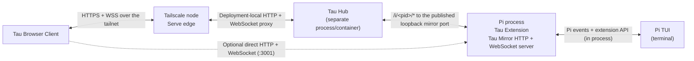

# Tau

> This is the [`itissid/tau`](https://github.com/itissid/tau) fork. It preserves Tau's terminal-owned session model and existing web interface while adding terminal-safe logging, loopback defaults, registry hardening, reverse-proxy path support, optional remote safety confirmations, and root-scope PWA/Web Push support for a compatible Tau Hub. See [FORK.md](FORK.md).

The Tau Browser Client mirrors your terminal-owned [Pi](https://github.com/badlogic/pi-mono) session in the browser. For direct access, the Tau Extension runs inside the owning Pi process, so no separate process is required. See [`CONTEXT.md`](CONTEXT.md) for canonical terminology.


## What it does

The Tau Browser Client attaches to a Tau Mirror owned by your running Pi process and gives you a second view in the browser. Same session, same messages, same tools — just a different screen. Type in the terminal or the browser, both stay in sync.

- **Live mirroring** — streams messages, tool calls, and thinking blocks in real-time
- **Works on any device** — open it on your phone, tablet, or another monitor
- **Session browser** — view history from any past session
- **No extra process for direct use** — the Tau Extension owns one process-scoped mirror for the Pi process's current session
- **Optional Tau Hub** — a separately managed single-origin proxy can discover and route several terminal-owned Tau Mirrors; see [`hub/README.md`](hub/README.md)

## Install

```bash
pi install npm:tau-mirror
```

Or from git:

```bash
pi install git:github.com/itissid/tau
```

## Usage

1. Start Pi normally in your terminal
2. Open the URL shown in the status bar (default: `http://localhost:3001`)
3. That's it

Type `/qr` in the terminal to show a QR code and scan it to access via your phone.

## Features

### Chat
- Full markdown rendering with syntax-highlighted code blocks
- Streaming responses with typing indicator
- Image attachments (paste, drag & drop, or button)
- Copy any message with one click
- Inline diff viewer for edit tool calls (red/green lines)
- Scroll-to-bottom button with new message indicator
- Message queuing — type while the agent is working, messages queue and auto-send

### Session Management
- Browse all past sessions grouped by project
- Full-text search across all session history with highlighted snippets
- Sorted by last modified (most recent first)
- Live session marked with a green dot
- Historical sessions are read-only
- Inline session rename
- Favourite sessions, tags, and filtering

### Model & Thinking
- Model picker with search/filter and keyboard support
- Thinking level toggle (off/low/medium/high)
- Token usage percentage with context window visualiser
- Cost tracking per session

### Voice Input
- Mic button in the input area using Web Speech API (on-device dictation)
- Live transcription into the textarea
- Pulses red while recording

### File Browser
- Right sidebar with lazy-loaded file tree
- Navigate directories, open files natively
- Drag files onto the input to insert their path

### Compaction
- Manual context compaction with status display
- Auto-compaction support

### PWA
- Installable as a standalone app on supported mobile and desktop browsers
- One root-scope service worker, with automatic removal of stale per-instance registrations
- Explicit notification opt-in and clear enabled, denied, unavailable, and unsupported states
- Background safety-permission alerts when used with a compatible Tau Hub Web Push service
- Notification taps return to the exact PID-scoped Tau Mirror at `/i/<pid>/`
- Custom app icons and network-first runtime caching

## Configuration

Environment variables (set before starting Pi):

| Variable          | Default     | Description                                                                  |
|-------------------|-------------|------------------------------------------------------------------------------|
| `TAU_MIRROR_PORT` | `3001`      | Server port                                                                  |
| `TAU_HOST`        | `127.0.0.1` | Loopback bind address (`127.0.0.1`, `::1`, or `localhost`)                   |
| `TAU_STATIC_DIR`  | *(bundled)* | Override static files path                                                   |
| `TAU_PENDING_DIR` | `~/.pi/tau-pending` | Bounded safety-request markers for a compatible local Tau Hub      |
| `TAU_DISABLED`    | `0`         | Set to `1` to disable Tau (it stays installed but won't start the server)    |
| `TAU_USER`        | *(none)*    | HTTP Basic Auth username (both `TAU_USER` and `TAU_PASS` required to enable) |
| `TAU_PASS`        | *(none)*    | HTTP Basic Auth password                                                     |

### Authentication

Tau supports optional HTTP Basic Auth (browser-native login popup).

**1. Set credentials** — add to `~/.pi/agent/settings.json`:

```json
{
  "tau": {
    "user": "pi",
    "pass": "your-password"
  }
}
```

Or via environment variables: `TAU_USER=pi TAU_PASS=secret pi`

**2. Toggle on/off** — once credentials are configured, a "Require login" toggle appears in Settings within the Tau web UI. Flip it on to start requiring authentication, off to open it back up. The setting persists across restarts.

Both HTTP and WebSocket connections are gated when enabled. The `/api/health` endpoint remains open for monitoring.

### Start / Stop

Control Tau at runtime without uninstalling:

```
/tau-stop     Stop the mirror server
/tau-start    Start it again
```

To prevent Tau from auto-starting (e.g. in multi-session or dev container workflows):

```bash
TAU_DISABLED=1 pi
```

You can still start it manually with `/tau-start` in that session.

## How it works

The Tau Extension is a [Pi extension](https://github.com/badlogic/pi-mono#extensions) that starts an HTTP + WebSocket server inside the Pi process. It subscribes to Pi events and forwards them to connected Tau Browser Clients. Commands from a browser client are executed through the extension API against the same terminal-owned Pi session.



For direct use, no Hub or Tailscale component is required. The Tau Extension auto-loads when Pi starts, owns the process-scoped Tau Mirror, and shuts it down when Pi exits.

For Hub-mediated remote access, the Tailscale node/Serve edge and Tau Hub are separately managed components. The Deployment Adapter decides their exact process and container placement. Tau Hub must be able to reach the Tau Mirrors' loopback listeners and validate their owning PIDs, which normally means sharing the Pi container's network and PID namespaces. Tau Hub may therefore run alongside Tailscale in one deployment, but it does not run *inside* Tailscale Serve.

## Development

Install the extension and Hub dependencies, then run their focused test suites:

```bash
git clone https://github.com/itissid/tau.git
cd tau
npm ci --ignore-scripts
npm --prefix hub ci --ignore-scripts
npm test
```

Point Pi directly at the checkout while developing:

```bash
ln -s "$(pwd)" ~/.pi/agent/extensions/tau-mirror
```

Edit files in `public/` and refresh the browser for frontend-only changes. Restart Pi after extension changes. See [`hub/README.md`](hub/README.md) for Hub tests and image builds.

### Making checkout changes available to Pi sessions

`~/.pi/agent/extensions/tau-mirror` is a global whole-directory link to this checkout, so Pi discovers the same Tau source regardless of which project directory under `~/workspace` starts the session. New Pi processes load the checkout's current extension code automatically.

Already-running Pi processes keep the extension modules and server lifecycle they loaded at startup. Restart those Pi sessions after changing `extensions/` or other extension-owned behavior; a clean restart is safer than hot reload for replacing Tau's in-process listener. Refresh the browser after `public/` changes and account for service-worker caching. Tau Hub is a separate process: changes under `hub/` require rebuilding/recreating the Hub deployment and do not require restarting unrelated Pi sessions.

## License

MIT
